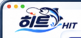

# 히트 HIT 브랜드·로고 기록

상태 갱신: 사용자가 확정 합성 JPG를 다시 제공했습니다. 현재 PC·모바일에 그 이미지의 동일한 물고기 로고 영역을 적용했습니다. 개별 벡터·투명 PNG는 여전히 미확보입니다. [구현 기록](20_APPROVED_UI.md).

상태: 선택 결정 확인 / 완전한 공식 로고 원본 미확보.

## 확인된 결정

- 사용자가 확정한 로고: 1번 물고기 '히트 HIT'
- 이전 답변의 설명: 물고기·낚싯줄·파도가 결합된 로고
- 모바일·PC 동일 로고 사용

## 보존 자료

이전 대화 첨부 파일 image(5).png를 변경 없이 보존했습니다. 창 테두리와 잘린 주변 요소가 포함된 작은 참고 이미지입니다. 벡터·투명 배경 로고 원본으로 취급하지 않습니다.

모바일 홈 참고 이미지의 로고는 위 참고 이미지와 다르게 보이며, 사용자는 이후 동일 로고 적용을 요청했습니다. 따라서 기존 모바일 로고를 공식 로고로 분리 등록하지 않았습니다.

## 미확보

완전한 로고 파일(SVG/AI/PNG), 정확한 색상 코드, 서체, 보호 공간, 최소 크기, 배경별 규칙, 사용권 자료. 이미지에서 임의로 추정하거나 새로 생성한 디자인을 확정본으로 대체하지 않았습니다.

출처와 한계: [SOURCE_STATUS.md](SOURCE_STATUS.md).

