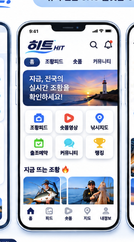

# UI 디자인 v1.1 기록

상태 갱신: 사용자가 PC 메인·모바일 홈·프로필을 포함한 확정 v1.1 합성 JPG를 다시 첨부하고 적용을 요청했습니다. 이 이미지를 기준으로 0.9.0 화면을 구현했습니다. 아래 미확보 설명은 최초 복구 당시 기록입니다. [구현 기록](20_APPROVED_UI.md).

상태: 확정 범위 확인 / 최종 화면 원본 미확보.

## 확정 범위

- PC 메인
- 모바일 홈
- 모바일 프로필
- 모바일과 PC에 동일한 공식 로고 사용
- 이전 답변에서 공통 색상·아이콘 스타일을 확정 기준으로 언급했으나 세부 값은 미확보

## 복구한 참고 이미지

파일명: 원본 image(4).png. 이미지 자체가 잘린 모바일 홈 시안입니다. 조황피드, 숏폼영상, 낚시지도, 출조예약, 커뮤니티, 랭킹 및 하단 내비게이션이 보입니다.

이 이미지는 모바일 로고를 PC와 통일해 달라는 요청에 첨부된 자료입니다. 요청 반영 후 확정 v1.1 결과물이라는 증거가 없으므로 최종 디자인으로 표시하지 않습니다.

## 누락 화면·사양

PC 메인 전체 이미지, 모바일 프로필, 로고 통일이 반영된 모바일 홈, 편집 가능한 원본, 화면 크기·간격·타이포그래피·색상 토큰, 반응형 전환 규칙 및 상호작용 상태.

원본 확보 후 각 화면과 공통 로고를 대조해야 합니다. 현재 자료만으로 픽셀 단위 구현을 확정할 수 없습니다.

출처와 한계: [SOURCE_STATUS.md](SOURCE_STATUS.md).

