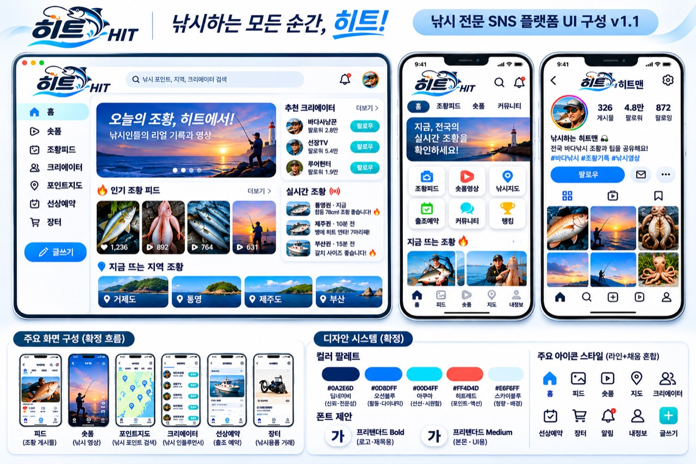

# 확정 UI v1.1 반영 — 0.9.0

사용자가 이 대화에 다시 첨부한 `사진 1.jpg`를 확정 디자인으로 명시하고 구현을 요청했습니다. 이전의 일부 복구 이미지를 대신해 이 시안을 현재 화면 구현 기준으로 사용합니다.

원본 JPG(1280×853)는 변경 없이 보존했습니다. PC 메인·모바일 홈·모바일 프로필, 주요 메뉴, 색상 팔레트가 함께 있는 합성 이미지입니다. CSS로 같은 원본의 로고·배너 영역을 표시하며 새로운 로고를 생성하지 않았습니다. PC·모바일은 같은 물고기 ‘히트 HIT’ 로고를 사용합니다.

## 반영

- 공통: 네이비 #0A2E6D, 블루 #0D8DFF, 아쿠아 #00D4FF, 코랄 #FF4D4D, 밝은 배경 #EFF6FF. 라인 아이콘·둥근 카드·그라데이션 버튼.
- PC 홈: 왼쪽 메뉴·글쓰기, 상단 지역 검색, 중앙 원본 배너·조황 카드·지역 탐색, 오른쪽 낚시인과 최근 조황.
- 모바일 홈: 같은 로고, 상단 메뉴, 배너, 6개 바로가기, 조황 카드와 하단 5개 메뉴.
- 프로필: 원형 사진·게시물/팔로워/팔로잉 수, 소개, 본인 편집 또는 팔로우, 사진 3열 목록.
- 기존 로그인·인증·작성·검색·소통·신고·차단·탈퇴·재시도 보호 기능 유지.
- 지역 카드에서 검색으로, 프로필 사진 목록에서 조황 상세로 연결.

## 실제 데이터와 미구현 범위

시안의 예시 인물·팔로워 수·조회 수·낚시 사진을 실제 계정이나 조황으로 넣지 않았습니다. 실제 API 결과로만 조황·작성자·팔로워 수를 표시합니다. 게시물 수는 현재 가져온 목록 수이며 다음 페이지가 있으면 `20+`처럼 표시합니다. 지금 눈여겨볼 조황은 현재 피드의 일부이며 전역 인기 순위가 아닙니다. 오른쪽 목록은 화면을 연 시점의 데이터이고 실시간 스트리밍이 아닙니다.

숏폼·선상예약은 준비 중 페이지로 연결합니다. 지도는 후속 0.16.0에서 지역 주변 지도와 조황 지역 검색으로 연결했습니다. 정확한 낚시 지점·GPS·조황 위치 핀은 제공하지 않습니다. 장터는 후속 0.15.0에서 상품 게시판으로 연결했습니다. 사진·가격·거래 지역·판매 상태를 등록하며 앱 내 결제·배송·채팅은 제공하지 않습니다. 인기 조황 랭킹은 후속 0.14.0에서 실제 좋아요 집계로 연결했습니다. 앱 안 알림은 후속 0.11.0에서 실제 기능으로 연결했습니다. 저장한 조황은 후속 0.10.0에서 실제 기능으로 연결했습니다. 실제 예약·결제·영상 재생처럼 동작한다고 표시하지 않습니다. 일반 프로필 조회·팔로우는 기존 기능으로 사용할 수 있습니다.

## 원본 한계

개별 로고의 SVG/투명 PNG와 고해상도 배너·사진, 편집 파일은 아직 없습니다. 합성 시안을 확대하므로 큰 PC 배너의 선명도에 한계가 있습니다. 배너는 정적 이미지이며 이미지 안에 그려진 점은 작동하는 슬라이드 버튼이 아닙니다. 지역 카드는 임의의 실제 장소 사진을 넣지 않고 그라데이션 배경으로 구성했습니다.

Pretendard는 우선 글꼴 이름으로 지정했지만 글꼴 파일은 포함하지 않았습니다. 설치되어 있지 않으면 기기 기본 글꼴로 표시됩니다. 아이콘은 제공 시안을 기준으로 코드로 만든 라인 아이콘이며 원본 벡터 추출본이 아닙니다. 픽셀 단위 완전 복제 또는 디자인 원본 복원이 끝났다고 주장하지 않습니다.

## 검증

PC 1440×960, 모바일 390×844, 작은 모바일 320×740에서 홈·프로필 확인. 모바일 홈·프로필의 가로 넘침 없음. 모바일 지도 바로가기 → 준비 중, 피드 복귀, 지역 카드 → 거제 검색 조건·빈 결과 안내를 확인했습니다. 기존 자동 검사 28개 통과. 실제 아이폰 조작·원본 글꼴 일치 검증은 별도입니다.

## 후속 변경 — 크리에이터 기능 삭제

사용자 요청으로 크리에이터 전용 메뉴·준비 중 화면을 삭제하고 향후 기능 범위에서도 제외했습니다. 일반 사용자 프로필·팔로우와 실제 조황 작성자 목록은 유지합니다. 보존한 원본 합성 시안은 당시 참고 자료로 남기며, 그 안의 크리에이터 표기는 현재 기능 요구사항으로 사용하지 않습니다.

후속 0.13.0에서 커뮤니티 게시판을 연결했습니다. 프로필은 조황·커뮤니티·본인 저장 탭으로 구성하며, 조황 수와 사진 목록은 조황 기준입니다. [구현 기록](24_COMMUNITY.md).
